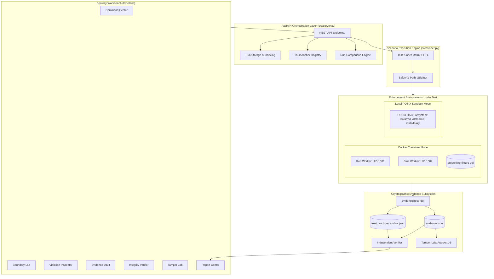

# BREACHLINE: Evidence-Producing Boundary-Test Harness for AI Evaluation Sandboxes

**Team:** NovaCrew  
**Team Lead:** Harsh Yadav  
**Competition:** Hack in Hills '26  
**Track:** Track 04 — Securing Adversarial AI Safety Testing Infrastructure  

---

## 1. Executive Summary & Core Philosophy

> **"Don't just claim isolation. Test the boundary. Verify the evidence."**

**BREACHLINE** is an empirical, evidence-producing boundary-test harness designed to evaluate access-control isolation across AI evaluation sandboxes. When sandboxing autonomous AI agents or untrusted workloads, teams frequently assume container names or separate networks guarantee isolation. In reality, improper filesystem permissions, world-readable volumes, and misconfigured mounts silently allow cross-tenant data leakage.

BREACHLINE tests configured access boundaries, compares expected permissions against observed outcomes, detects mismatches, and creates structured, cryptographically hash-linked evidence records using canonical SHA-256 serialization.

### The Fundamental Independence of Results

BREACHLINE strictly differentiates between two independent results:

| Result Dimension | Possible Values | Definition |
| :--- | :--- | :--- |
| **POLICY RESULT** | `PASS` or `FAIL` | Did the observed access operation match the expected policy permission? |
| **EVIDENCE RESULT** | `VALID` or `INVALID` | Does the evidence log pass independent cryptographic integrity checks? |

#### Example: Negative Control Scenario (Test T4)
* **Expected:** `DENY`
* **Observed:** `ALLOW`
* **Policy Result:** `FAIL` (A policy failure was detected because access succeeded unexpectedly)
* **Evidence Result:** `VALID` (The evidence chain recording this failure is intact and untampered)

**Important Security Distinction:** BREACHLINE evaluates boundaries and produces evidence. The operating system kernel (Linux DAC) and container runtime enforce isolation. BREACHLINE does not enforce isolation itself.

---

## 2. System Architecture



---

## 3. Technology Stack

- **Core Language:** Python 3.10+ (tested on Python 3.11, 3.12, 3.14).
- **Backend Framework:** FastAPI & Uvicorn (local REST API).
- **Frontend Workbench:** Vanilla HTML5, CSS3, JavaScript (no external npm dependencies or CDN CDNs required).
- **Testing Framework:** pytest (37 automated unit & integration tests, 100% passing).
- **Environment:** Docker Compose (hardened non-root containers) with fallback to Local-First POSIX DAC Sandbox.
- **Evidence Storage:** JSON Lines (JSONL) with canonical lexicographical serialization.
- **Cryptographic Hashing:** Canonical SHA-256 hash chaining linked to a documented 64-zero genesis block.
- **Trust Anchoring:** External immutable run commitment storage defending against full-chain rewrite attacks.

---

## 4. Project Structure

```
BREACHLINE/
|-- breachline                  # Executable root CLI wrapper
|-- README.md                   # Complete system documentation
|-- requirements.txt            # Python dependencies (pytest, fastapi, uvicorn, pydantic, requests)
|-- docker-compose.yml          # Container configuration for sandbox and workers
|-- Dockerfile.red              # Hardened non-root Red worker (UID 1001)
|-- Dockerfile.blue             # Hardened non-root Blue worker (UID 1002)
|-- Dockerfile.runner           # Containerized test runner
|
|-- config/
|   |-- test_cases.json         # Matrix of boundary test cases (T1, T2, T3, T4)
|   |-- policy.json             # Policy specification for evaluation sandboxes
|
|-- src/
|   |-- cli.py                  # Unified command-line interface
|   |-- server.py               # FastAPI backend server exposing REST endpoints
|   |-- runner.py               # Multi-mode scenario execution engine
|   |-- models.py               # Data models and canonical JSON serializer
|   |-- evidence.py             # Hash-chained evidence recorder
|   |-- verifier.py             # Independent cryptographic verifier
|   |-- storage.py              # Multi-run persistence, indexing, and diff comparison
|   |-- boundary_lab.py         # Path validation, worker definitions, and probe checks
|   |-- local_sandbox.py        # Local-first POSIX DAC environment and executor
|   |-- tamper.py               # Safe disposable evidence tampering lab (Attacks 1-5)
|   |-- report.py               # Multi-format report generator (HTML, JSON, TXT)
|   |-- static/                 # Security Workbench web application
|       |-- index.html          # Dashboard HTML with 10 interactive views
|       |-- style.css           # Dark navy SOC design system
|       |-- app.js              # Workbench client logic
|
|-- workers/
|   |-- worker.py               # Non-root worker service executing OS operations
|
|-- fixtures/
|   |-- red/red_secret.txt      # Confidential Red tenant credential (mode 0600)
|   |-- blue/blue_secret.txt    # Confidential Blue tenant benchmark (mode 0600)
|   |-- leaky/blue_leaked.txt   # Misconfigured fixture (mode 0644 - Negative Control)
|
|-- tests/
|   |-- test_evidence.py        # Canonical hashing and chaining unit tests
|   |-- test_verifier.py        # Verifier detection tests (tampering & rewrite limitation)
|   |-- test_runner.py          # Runner and negative control tests
|   |-- test_reports.py         # Multi-format report structure tests
|   |-- test_storage.py         # Multi-run persistence & diff comparison tests
|   |-- test_boundary_lab.py    # Path traversal rejection & DAC tests
|   |-- test_tamper_lab.py      # Automated 5-attack tamper laboratory tests
|   |-- test_api.py             # FastAPI REST endpoints integration tests
|
|-- scripts/
|   |-- run_demo.sh             # 90-second automated end-to-end demonstration
|   |-- tamper_demo.sh          # Interactive 5-attack tampering simulation
|   |-- verify_evidence.sh      # Standalone verification helper
|
|-- output/
|   |-- evidence.jsonl          # Latest tamper-evident audit log
|   |-- report.html             # Standalone interactive audit report
|   |-- report.json             # Machine-readable report
|   |-- report.txt              # Human-readable summary report
|   |-- runs/                   # Multi-run historical database
|       |-- index.json          # Master run catalog and metadata
|       |-- <run_id>/           # Run-isolated evidence and reports
|   |-- tamper_scratch/         # Disposable copies for tamper simulations
|   |-- local_sandbox/          # Isolated local filesystem test fixtures
|
|-- docs/
    |-- ARCHITECTURE.md         # Detailed architectural and topological specification
    |-- SECURITY_MODEL.md       # Threat model, in-scope vs out-of-scope boundaries
    |-- LIMITATIONS.md          # Technical disclosures & macOS VirtioFS translation
    |-- DEMO_SCRIPT.md          # 2-minute competitive judge presentation script
```

---

## 5. Quickstart: Installation & Startup Commands

### Step 1: Install Dependencies
```bash
pip install -r requirements.txt
```

### Step 2: Run Automated Test Suite (37 Tests)
```bash
python3 -m pytest tests/ -v
```
*(All 37 unit and integration tests execute and pass in ~0.36s)*

### Step 3: Run the 90-Second Complete Demonstration
```bash
./scripts/run_demo.sh
```
*Or via the unified CLI:*
```bash
./breachline demo
```

### Step 4: Launch the Web Security Workbench
```bash
# Default port (8000):
./breachline serve

# Or specify a custom port if 8000 is in use:
./breachline serve --port 8008
```
Open your browser to: **`http://localhost:8008/`** (or `http://localhost:8000/`)

> **Port Conflict Diagnostics:** If your configured port is occupied by another local service (e.g., `lsof -i :8000`), BREACHLINE reports clear diagnostics with PID details rather than crashing, and instructs starting on an alternative port (`--port <number>`).

---

## 6. Execution Modes & OS Enforcement Architecture

BREACHLINE strictly distinguishes between actual OS-enforced testing and application-level simulation. Execution modes are evaluated as follows:

| Mode | `is_os_enforced` | Enforcement Mechanism | Cross-UID Isolation | Use Case |
| :--- | :---: | :--- | :---: | :--- |
| **`docker`** | **`True`** | **Linux Kernel POSIX DAC** inside separate non-root containers | **Yes** (UID 1001 vs 1002) | **Primary Benchmark:** Real kernel-level boundary testing. |
| **`local_os`** | **`True`** | **Host POSIX Kernel DAC** via direct OS syscalls (`open()`, `stat()`) | Limited to host process identity | Tests host kernel mode bits (`0000` denied, `0644` allowed). |
| **`simulated`** *(alias: `local_sandbox`)* | **`False`** | Application-level role branching (explicitly flagged) | No (Simulated roles) | Offline logic demonstration only; **not** OS-enforced. |
| **`auto`** | Auto | Probes Docker workers; uses `docker` if online, else warns and falls back to `simulated`. | Depends on mode resolved | Convenience default for demonstrations. |

### A. Docker Container Mode (Genuine OS Enforcement)
- **Red Worker Container (`breachline-red-worker`):** Non-root UID `1001:1001`, `read_only: true`, `cap_drop: [ALL]`, `no-new-privileges: true`. Listens on port 8081.
- **Blue Worker Container (`breachline-blue-worker`):** Non-root UID `1002:1002`, identically hardened. Listens on port 8082.
- **Fixture Volume (`breachline-fixture-vol`):** Isolated Linux ext4 Docker volume initialized by `breachline-fixture-init`. Guarantees exact POSIX DAC ownership (`1001:1001` for red, `1002:1002` for blue) and permission bits (`0700` directories, `0600` secret files) immune to macOS VirtioFS translation anomalies.
- **OS Error Capture:** The non-root worker attempts real filesystem read operations (`with open(target_path)`). Unauthorized cross-tenant reads trigger genuine Linux kernel `PermissionError: [Errno 13] Permission denied`, returning `exit_code: 1`.
- **Startup & Execution Commands:**
  ```bash
  docker compose up -d fixture-init red-worker blue-worker
  ./breachline run --mode docker
  ```

### B. Execution Errors vs. Policy Denials (Requirement 5)
BREACHLINE maintains a strict firewall between execution failures and policy denials:
- **Execution Errors:** Timeouts, unreachable worker services, HTTP connection drops, path validation rejections, or process aborts (exit code $\ge 125$) are mapped to `actual_outcome: "ERROR"` and `policy_result: "FAIL"`.
- **Under NO circumstances** is an infrastructure or execution failure classified as a successful `DENY` policy outcome.

### C. Scope of Assurance (Requirement 16)
> [!IMPORTANT]
> **No Guarantee of Overall Sandbox Security:**
> BREACHLINE evaluates whether configured Discretionary Access Control (DAC) boundaries and file mode bits are enforced by the operating system for designated test paths. It does **NOT** guarantee that a sandbox is impervious to container escape exploits, hypervisor compromises, zero-day kernel vulnerabilities, network exfiltration, or hardware side-channels. Furthermore, evidence integrity is tamper-evident via hash chaining, but full-chain rewrite protection requires external ledger anchoring.

---

## 7. The Standard Test Matrix

| Test ID | Role | Target Path | Target Mode | Expected | Actual | Policy Result | Technical Interpretation |
| :--- | :--- | :--- | :--- | :--- | :--- | :--- | :--- |
| **T1** | `red-worker` | `/data/red/red_secret.txt` | `0600` (Owner 1001) | `ALLOW` | `ALLOW` | **PASS** | Permitted read of worker's own credential |
| **T2** | `red-worker` | `/data/blue/blue_secret.txt` | `0600` (Owner 1002) | `DENY` | `DENY` | **PASS** | Prohibited cross-tenant read denied by kernel DAC |
| **T3** | `blue-worker` | `/data/blue/blue_secret.txt` | `0600` (Owner 1002) | `ALLOW` | `ALLOW` | **PASS** | Permitted read of worker's own benchmark |
| **T4** | `red-worker` | `/data/leaky/blue_leaked.txt`| `0644` (World-readable)| `DENY` | `ALLOW` | **FAIL** | **Negative Control:** Proves harness catches misconfigurations |

---

## 8. Evidence Vault & Cryptographic Verification

### Canonical Serialization
To guarantee deterministic SHA-256 hashing regardless of Python dictionary implementation or JSON library variations:
1. Lexicographically sorted keys (`sort_keys=True`).
2. Compact separators without whitespace (`separators=(",", ":")`).
3. Exact UTF-8 byte encoding.
4. The calculated `record_hash` is explicitly excluded from its own payload.

### Hash Chaining
```
Genesis: 0000000000000000000000000000000000000000000000000000000000000000
    |
    v (Record 1 previous_record_hash = Genesis)
Record 1 [T1]: Hash = 9b743d36dc837489ef84acd91b0ed2beb3c55b8f...
    |
    v (Record 2 previous_record_hash = Record 1 Hash)
Record 2 [T2]: Hash = 32ab0ee5b3d21b687b25a646098728ec0631fa2ad...
    |
    v (Record 3 previous_record_hash = Record 2 Hash)
Record 3 [T3]: Hash = 360b264b848e07af1128b119dae187f3d15cc77ef...
    |
    v (Record 4 previous_record_hash = Record 3 Hash)
Record 4 [T4]: Hash = f77c65ba90a5442c19248967562bf5480e0bee6b4...
```

### Verification Command & Independent Trust Anchoring
```bash
./breachline verify output/evidence.jsonl
```
When verifying, BREACHLINE performs two distinct integrity checks:
1. **Internal Cryptographic Hash Chain:** Recomputes every SHA-256 digest from canonical JSON payloads and validates links to the genesis block.
2. **External Independent Trust Anchor:** Matches the chain's tip-hash against the separately stored commitment in `output/trust_anchors/<run_id>.anchor.json`.

---

## 9. Evidence Tampering Laboratory (5 Attack Vectors)

Execute the disposable tampering demonstration via CLI or through the web UI:
```bash
./breachline tamper --attack all
```

| Attack Vector | Transformation Applied | Verifier Output | Trust Anchor Check | Security Significance |
| :--- | :--- | :--- | :--- | :--- |
| **Attack 1: Field Tampering** | Attacker flips `result` from `FAIL` to `PASS` on T4 | **[DETECTED]** `RECORD_HASH_MISMATCH` | N/A | Proves audit log cannot be edited in place without hash divergence. |
| **Attack 2: Record Deletion** | Attacker deletes record 2 (T2) entirely | **[DETECTED]** `SEQUENCE_BREAK` | N/A | Sequence jump and hash link pointer gap are immediately flagged. |
| **Attack 3: Record Reordering**| Attacker swaps chronological order of T1 and T2 | **[DETECTED]** `SEQUENCE_BREAK` | N/A | Genesis check and sequence ordering enforce chronological integrity. |
| **Attack 4: Broken Hash Link** | Attacker corrupts `previous_record_hash` | **[DETECTED]** `HASH_CHAIN_DISCONTINUITY` | N/A | Spliced log segments are immediately rejected. |
| **Attack 5: Full-Chain Rewrite**| Attacker alters T4 AND recalculates all hashes | **[LIMITATION DEMO]** `PASS` (Self-consistent) | **[CAUGHT BY ANCHOR]** `ANCHOR_DIVERGED_MISMATCH` | **Dual Defense:** Proves the local hash chain limitation, while demonstrating that the independent external trust anchor catches the rewrite. |

---

## 10. Honest Security Disclosures & Known Limitations

1. **Evidence is Tamper-Evident, Not Tamper-Proof:**
   A hash-linked chain without an independently trusted anchor mathematically proves relative internal consistency. It does not prove absolute historical authenticity against an adversary with write access to the storage system who rewrites the entire file. Production environments should anchor tip hashes to RFC 3161 timestamp witnesses or transparency logs (e.g., Sigstore Rekor).
2. **BREACHLINE Does Not Enforce Isolation:**
   The operating system kernel and container runtime enforce boundaries. BREACHLINE stimulates, measures, and documents boundary enforcement.
3. **Scope of Boundary Probes:**
   Current test matrix evaluates local POSIX DAC filesystem boundaries. Kernel privilege escalations, dirty pipe exploits, and network packet injection are out of scope.
4. **macOS Docker Desktop Filesystem Semantics:**
   Host bind-mounts using VirtioFS / osxfs on macOS translate host permissions, granting non-root container users access to host files. BREACHLINE mitigates this by running an initialization container on a native Linux Docker volume.

---

## 11. Command-Line Reference

```bash
# Run boundary tests
./breachline run [--mode auto|docker|local_sandbox|demo] [--config path]

# Run full 90-second automated demo
./breachline demo

# Verify an evidence log
./breachline verify [path/to/evidence.jsonl]

# Run tampering simulation
./breachline tamper [--attack 1|2|3|4|5|all]

# Generate HTML, JSON, and TXT reports
./breachline report [--evidence path]

# Compare two execution runs
./breachline compare <run_id_a> <run_id_b>

# Inspect system status and diagnostics
./breachline status

# Start web workbench server
./breachline serve [--host 127.0.0.1] [--port 8000]
```

---

## 12. Team Credits

- **Event:** Hack in Hills '26
- **Track:** Track 04 — Securing Adversarial AI Safety Testing Infrastructure
- **Team:** NovaCrew
- **Team Lead:** Harsh Yadav
